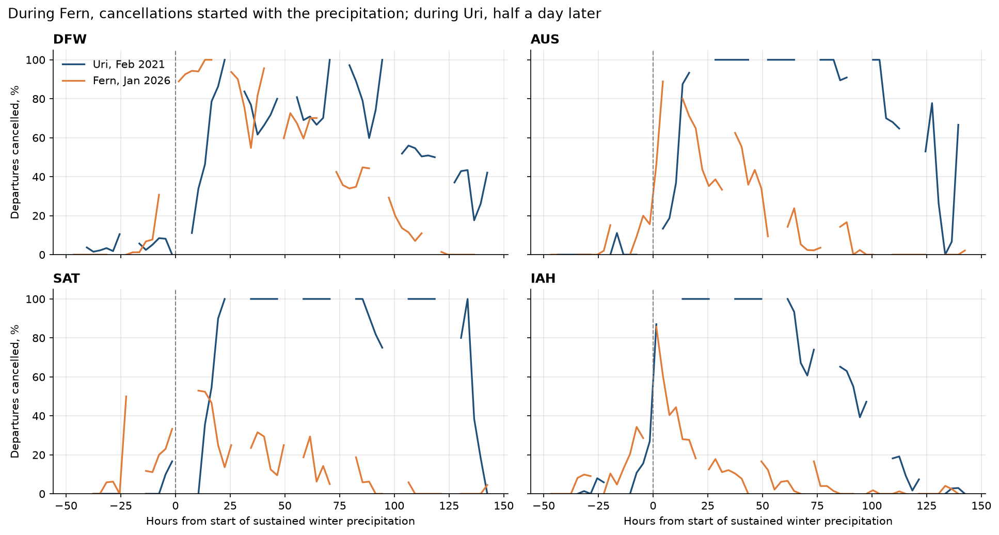
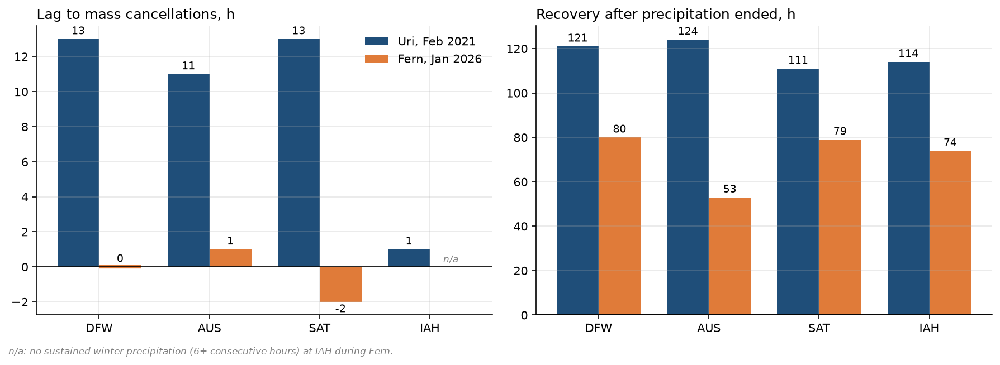
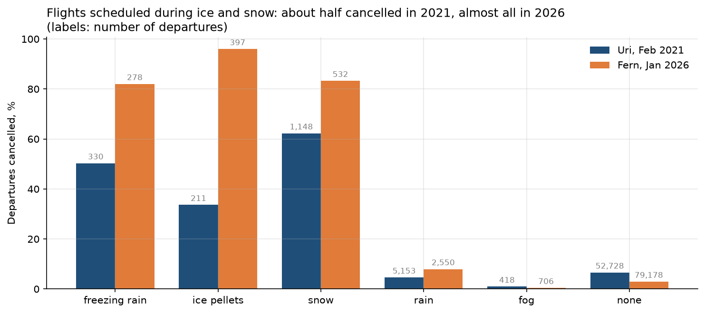
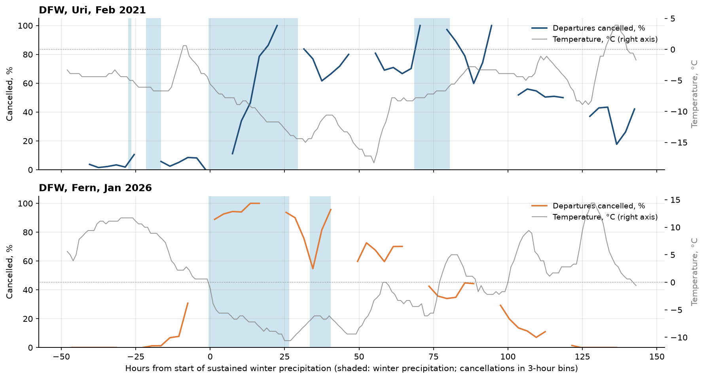
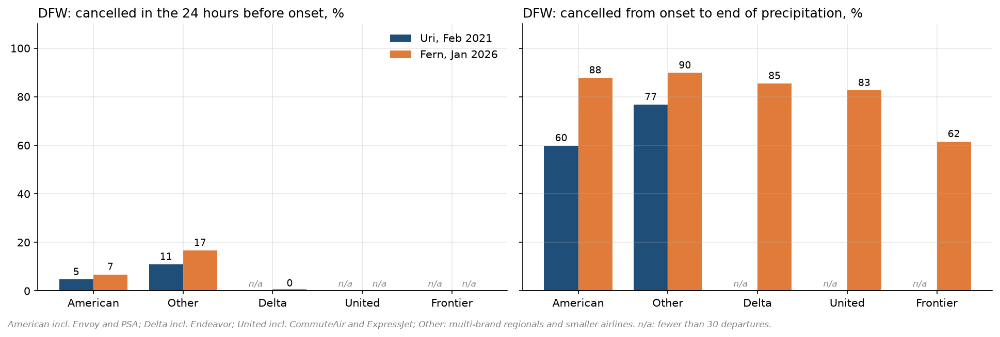
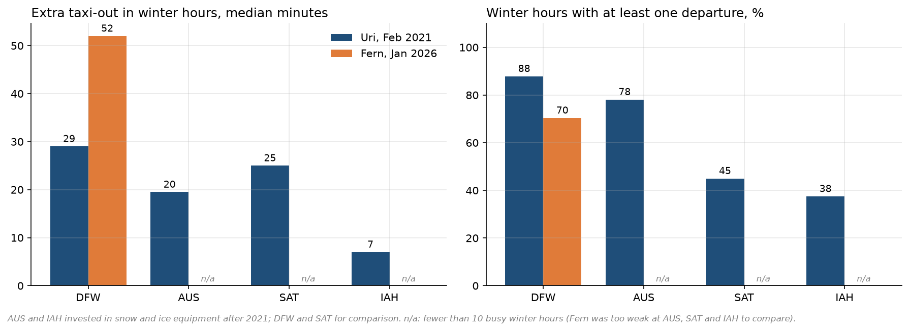
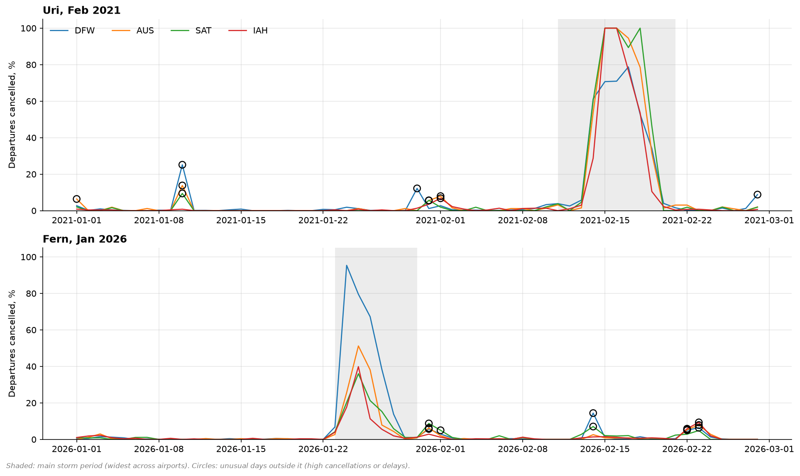
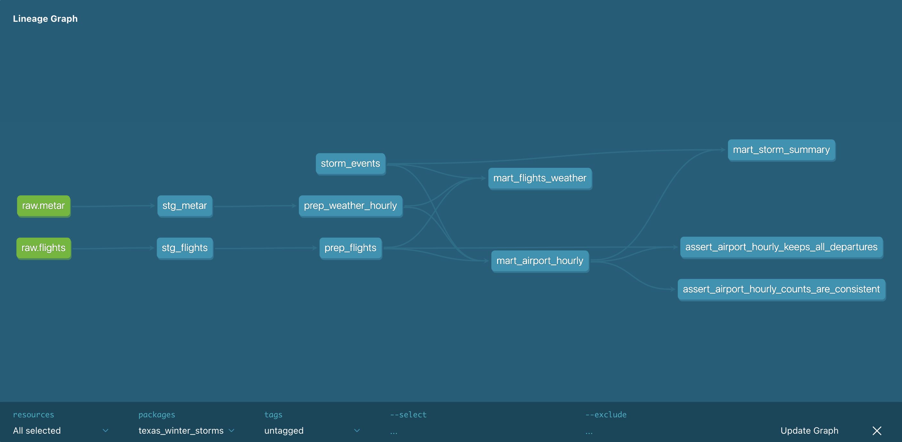

# Texas Winter Storms vs. Flights

How did two winter storms disrupt flights at Texas's four largest airports (DFW, IAH, AUS, SAT),
and did airports and airlines handle **Winter Storm Fern (January 2026)** better than
**Winter Storm Uri (February 2021)**?

An end-to-end analytics engineering project: Python ingestion of public flight and weather data,
a tested dbt pipeline on DuckDB, and an analysis notebook.



## Key findings

1. **Airlines reacted much faster in 2026.** During Uri, mass cancellations (50 %+ of departures)
   started 11–13 hours after sustained winter precipitation began at DFW, AUS and SAT.
   During Fern they started in the same hour (DFW), one hour later (AUS) or two hours *before*
   the precipitation (SAT).
2. **Airlines stopped flying into the ice.** Of the flights scheduled during freezing rain, ice
   pellets or snow, about half were cancelled during Uri (34–62 %) and almost all during Fern
   (82–96 %). Cancellations a day ahead rose only modestly (for example 2 → 7 % at DFW): the
   change happened when the ice arrived, not a day before.
3. **Hub protection disappeared.** During Uri, American cancelled fewer of its DFW departures than
   other carriers (60 % vs. 77 %) and its flights in ice and snow left with a median of 11 minutes
   of extra delay; United showed the same pattern at its IAH hub (88 % vs. 100 %). This explains
   why the coldest airport, DFW, cancelled the fewest flights during Uri. During Fern every
   airline at DFW cancelled 83–90 %, American included, and the few American flights that operated
   in winter hours left with a median of almost two hours of extra delay.
4. **Recovery was 1.5–3 days faster after Fern** (53–80 hours vs. 111–124 hours after the
   precipitation ended). Uri was followed by days of extreme cold and a power grid failure,
   so not all of the difference is down to preparedness.
5. **The data cannot confirm that new airport equipment helped.** Austin and Houston invested in
   snow and ice equipment after Uri, but Fern brought only 4 busy winter hours to AUS and one to
   IAH, too few to compare. At DFW, the one airport with comparable weather, operations in
   winter hours did not improve.

| Airport | Storm | Winter precip. hours | Lag to mass cancellations | Recovery | Cancelled 24 h before | Cancelled during disruption |
|---|---|---:|---:|---:|---:|---:|
| DFW | Uri 2021  | 36 | 13 h | 121 h | 2 %  | 53 % |
| DFW | Fern 2026 | 34 | 0 h  | 80 h  | 7 %  | 59 % |
| AUS | Uri 2021  | 34 | 11 h | 124 h | 0 %  | 67 % |
| AUS | Fern 2026 | 14 | 1 h  | 53 h  | 11 % | 44 % |
| SAT | Uri 2021  | 37 | 13 h | 111 h | 4 %  | 65 % |
| SAT | Fern 2026 | 13 | −2 h | 79 h  | 11 % | 23 % |
| IAH | Uri 2021  | 19 | 1 h  | 114 h | 13 % | 68 % |
| IAH | Fern 2026 | 3  | n/a  | 74 h  | 18 % | 19 % |

Fern was much weaker than Uri at AUS, SAT and IAH, so their lower cancellation rates partly
reflect milder weather. At IAH Fern brought only 3 hours of winter precipitation and no
sustained period, so no lag can be computed.

<p float="left">
  
  
</p>

### DFW: comparable storms, different response

Both storms brought about 35 hours of winter precipitation to DFW. During Fern cancellations
came at once and ended sooner; during Uri they started half a day late and lasted for days.





### Airports: no measurable effect of new equipment

Where a comparison was possible (DFW), fewer winter hours kept departures going during Fern
(70 % vs. 88 %), and the flights that did operate taxied longer (+52 vs. +29 minutes over a
normal hour). This fits the airlines' new strategy rather than a better-run airfield. At AUS,
SAT and IAH Fern was too weak to compare; this is reported as a limitation, not as a result.



### Anomalies

Days with 5 %+ of departures cancelled outside the main storms fall into three groups:

- **local snow or ice:** a one-day snowfall on 10 January 2021, a month before Uri;
- **local thunderstorms:** three days at DFW, the only days with many diverted arrivals (31–48,
  against none on a normal day). One of them, 28 February 2021, had been an unexplained
  diversion spike in an earlier version of this analysis;
- **weather elsewhere in the network:** clear weather at the airport, but aircraft and crews
  held up by storms in other parts of the country.



## Data

| Source | What | Granularity |
|---|---|---|
| [BTS On-Time Performance](https://www.transtats.bts.gov/) | Every domestic flight: schedule, delays, taxi-out time, cancellations with reason codes (carrier, weather, air traffic control, security) | One row per flight, monthly files |
| [IEM METAR archive](https://mesonet.agron.iastate.edu/request/download.phtml) | Weather observations from the airports' own stations, including present weather codes (`FZRA`, `PL`, `SN`, `TS`, …), gusts, visibility and ice accretion | Hourly routine reports plus special reports when the weather changes |

Data windows: January–February 2021 (Uri) and January–February 2026 (Fern) for DFW, IAH, AUS
and SAT: 277,282 flights and 13,220 weather reports. No API keys are needed.

## Pipeline

```
BTS ZIP files ─┐                    ┌─ staging ── prep ── marts ─┐
               ├─ Python ─ Parquet ─┤          dbt + DuckDB      ├─ notebook ─ charts
IEM METAR CSV ─┘                    └────────────────────────────┘
```



| Layer | Models | What happens |
|---|---|---|
| Ingestion | `ingest/flights.py`, `ingest/weather.py` | Download, filter to the four airports, keep source column names, write Parquet. Driven by `config/project.yml` |
| Staging | `stg_flights`, `stg_metar` | Renaming, types, decoded cancellation reasons, US units to metric, UTC to local time |
| Prep | `prep_flights`, `prep_weather_hourly` | Local timestamps from BTS `hhmm` times; one row per airport and hour with weather parsed from METAR codes |
| Marts | `mart_flights_weather`, `mart_airport_hourly`, `mart_storm_summary` | Flights with the weather at departure; airport hours with cancellations next to weather; one row per storm and airport with timing metrics |

The project has 37 dbt tests: keys, accepted values, relationships, and two singular tests that
check counts across models (every departure lands in exactly one airport hour; cancellations by
reason add up to the total).

## Analysis

`analysis/storm_comparison.ipynb` reads only the marts and saves every chart to `docs/images/`:

1. storm summary per airport;
2. cancellations hour by hour around the storm onset;
3. reaction and recovery times;
4. cancellations by the weather at departure;
5. DFW hour by hour;
6. airport operations in ice and snow (taxi-out, delays, hours with departures);
7. airlines: who changed their strategy;
8. anomalies: unusual days outside the storms and anomalies in the data itself.

## Method

Storm boundaries come from the weather, with the same rules for both storms and all airports:

- **Winter hour:** an hour in which any METAR report mentions freezing rain or drizzle, ice pellets
  or snow. Codes in the vicinity (`VC`), blowing (`BL`) and drifting (`DR`) do not count.
- **Main episode:** winter hours separated by 24+ dry hours form episodes; the storm is the
  episode with the most winter hours within ±3 days of the approximate dates.
- **Sustained onset:** the first hour of the main episode that starts 6+ consecutive winter hours.
- **Mass cancellation:** the first hour with 3+ scheduled departures and 50 %+ cancelled.
- **Recovery:** hours from the end of precipitation until cancellations stay below 10 % for six
  busy hours in a row.

Times are local (US Central). Flights are matched to the weather of their **scheduled** departure
hour, because cancelled flights have no actual departure.

## Data quality decisions

Several choices came from checking the data rather than trusting it:

- **Weather source.** Meteostat was the first choice, but for 2026 almost all weather condition
  codes were filled from forecast models, and the observed codes showed no snow or ice at DFW
  during Fern. The pipeline switched to the IEM archive of raw METAR reports, which gives the
  same source and format for both years.
- **Weather station for Austin.** Meteostat station `72254` is Camp Mabry, a city station about
  16 km from the airport. The airport station (`KAUS`) is used instead.
- **Storm boundaries.** The first rule took the *first* winter episode near the storm dates.
  For Uri that picked up a separate icing event on 11 February 2021, so the rule was changed to
  the episode with the most winter hours.
- **Onset definition.** Uri began with more than a day of light, intermittent freezing drizzle.
  Measured from the first icy hour, the lag to mass cancellations at SAT is 52 hours; measured from
  sustained precipitation, 13 hours. Both are kept in `mart_storm_summary`.
- **Cancelled but delayed.** BTS reports a departure delay for some cancelled flights (they left
  the gate, e.g. for de-icing, and were cancelled afterwards). A consistency test caught this;
  only operated flights count as delayed.
- **Precipitation gauge.** During Fern the DFW gauge reported 22–43 mm per hour for six hours in a
  row while ice pellets and light snow fell at −7 to −9 °C, which is physically implausible.
  Storm timing is therefore based on weather codes, not precipitation amounts.
- **Hour grid.** A report at 23:53 on the last day of a month was shifted into the next month and
  added a month of empty hours. Checking row counts against the expected number caught it while
  all tests were passing.

## Limitations

- Fern was too weak at AUS, SAT and IAH for most comparisons; DFW is the only airport with
  comparable weather in both storms.
- METAR codes describe precipitation that is falling, not snow or ice lying on the runways. Most
  cancellations in both storms fell in hours without falling precipitation: before the storm
  (cancelled in advance) or after it.
- Cancellation reason codes are reported by the airlines themselves and are almost always
  "weather", including weather elsewhere in their network.
- BTS reports the operating carrier; regional carriers flying for several brands cannot be
  assigned to one. Southwest serves Dallas and Houston mainly from Love Field and Hobby, which
  are not part of this project.
- 2021 traffic was reduced by COVID-19, so the analysis compares rates, not counts.
- Weather comes from one station per airport.

## Run it yourself

Requires Python 3.11+.

```bash
git clone https://github.com/dinagudkova/texas-winter-storms.git
cd texas-winter-storms
python -m venv .venv && source .venv/bin/activate
pip install -r requirements.txt

# 1. Ingest flights (BTS) and weather (IEM) for the storms in config/project.yml
python -m ingest.flights
python -m ingest.weather

# 2. Build and test the dbt models (always run dbt from the dbt/ folder)
cd dbt
dbt seed
dbt build
dbt docs generate && dbt docs serve   # optional: documentation and lineage graph

# 3. Open analysis/storm_comparison.ipynb and run all cells
```

To add another storm, add it to `config/project.yml` and `dbt/seeds/storm_events.csv`
and rerun the steps above.

## Project structure

```
config/project.yml        airports, weather stations and storm windows
ingest/                   Python ingestion scripts (BTS flights, IEM METAR)
dbt/
  models/staging/         one model per source
  models/prep/            local timestamps, hourly weather
  models/marts/           analysis-ready tables
  macros/                 METAR value parsing, hhmm time parsing
  seeds/                  storm events
  tests/                  singular tests
analysis/                 analysis notebook
docs/images/              charts and lineage graph
```

**Stack:** Python, pandas, DuckDB, dbt Core, matplotlib.
